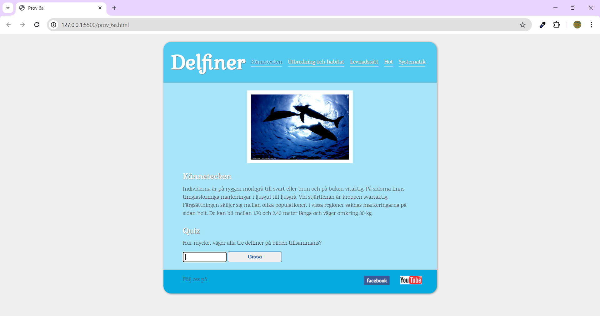
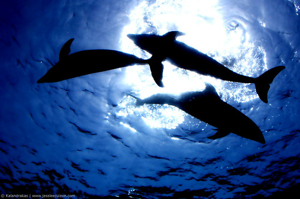

# Prov 6



## Instruktioner
* Skapa en sida som ser ut som skärmdumpen ovan.
* Designen är 700px bred.
* Placera designen ”centrerat” på sidan.
* Skapa en ”menyn” med rollover-effekt (understruken) och vald-effekt (ljusgrå) som på bilden.
* Skapa också en ”quiz” med Javascript som kollar om användaren svara rätt på frågan.

## Dokumentation
Du får titta på följande sidor:
* [HTML](https://www.w3schools.com/html)
* [CSS](https://www.w3schools.com/css/default.asp)
* [Javascript](https://www.w3schools.com/js/default.asp)

## Kvalité
* Kommentera din kod.
* Indentera din kod så den är tydlig att följa.

## Typsnitt som används

* Använd typsnittet Karma från Google Fonts.

I HTML:
```html
<link rel="preconnect" href="https://fonts.googleapis.com">
<link rel="preconnect" href="https://fonts.gstatic.com" crossorigin>
<link href="https://fonts.googleapis.com/css2?family=Abril+Fatface&family=Karma:wght@300;400;500;600;700&family=Noto+Sans:ital,wght@0,100..900;1,100..900&display=swap" rel="stylesheet">
```
I CSS:
```css
  font-family: "Karma", serif;
  font-weight: 500;
  font-style: normal;
```

## Text som används
> Kännetecken Utbredning och habitat Levnadssätt Hot Systematik

> Kännetecken\
> Individerna är på ryggen mörkgrå till svart eller brun och på buken vitaktig. På sidorna finns timglasformiga markeringar i ljusgul till ljusgrå. Vid stjärtfenan är kroppen svartaktig. Färgsättningen skiljer sig mellan olika populationer, i vissa regioner saknas markeringarna på sidan helt. De kan bli mellan 1,70 och 2,40 meter långa och väger omkring 80 kg.

> Quiz\
> Hur mycket väger alla tre delfiner på bilden tillsammans?

> Följ oss på:

## Färger som används

* <code style="background:#f0f0f0; color:#000">#f0f0f0</code>
* <code style="background:#53cbf1; color:#000">#53cbf1</code>
* <code style="background:#a9e5f8; color:#000">#a9e5f8</code>
* <code style="background:#1456AC; color:#fff">#1456AC</code>
* <code style="background:#888; color:#fff">#888</code>
* <code style="background:#696969; color:#fff">#696969</code>
* <code style="background:#000; color:#fff">#000</code>

## Bilder som används

### Delfiner


### Sociala medier


## Skärmdumpar

### Klick

När man klickat på "knappen" ska en ruta visas:


