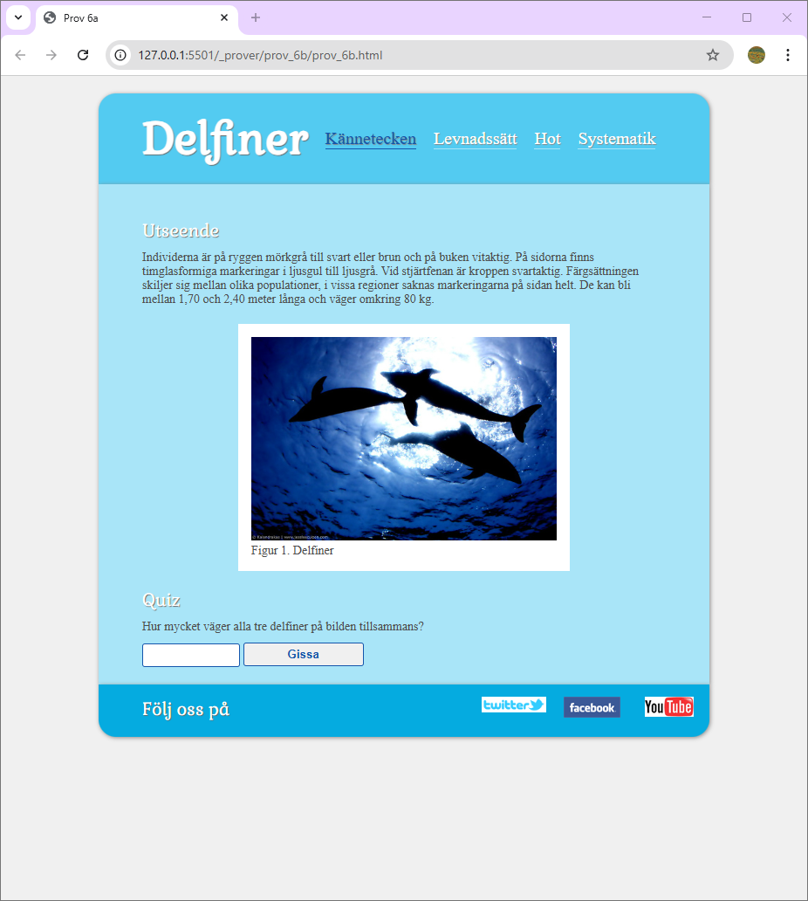
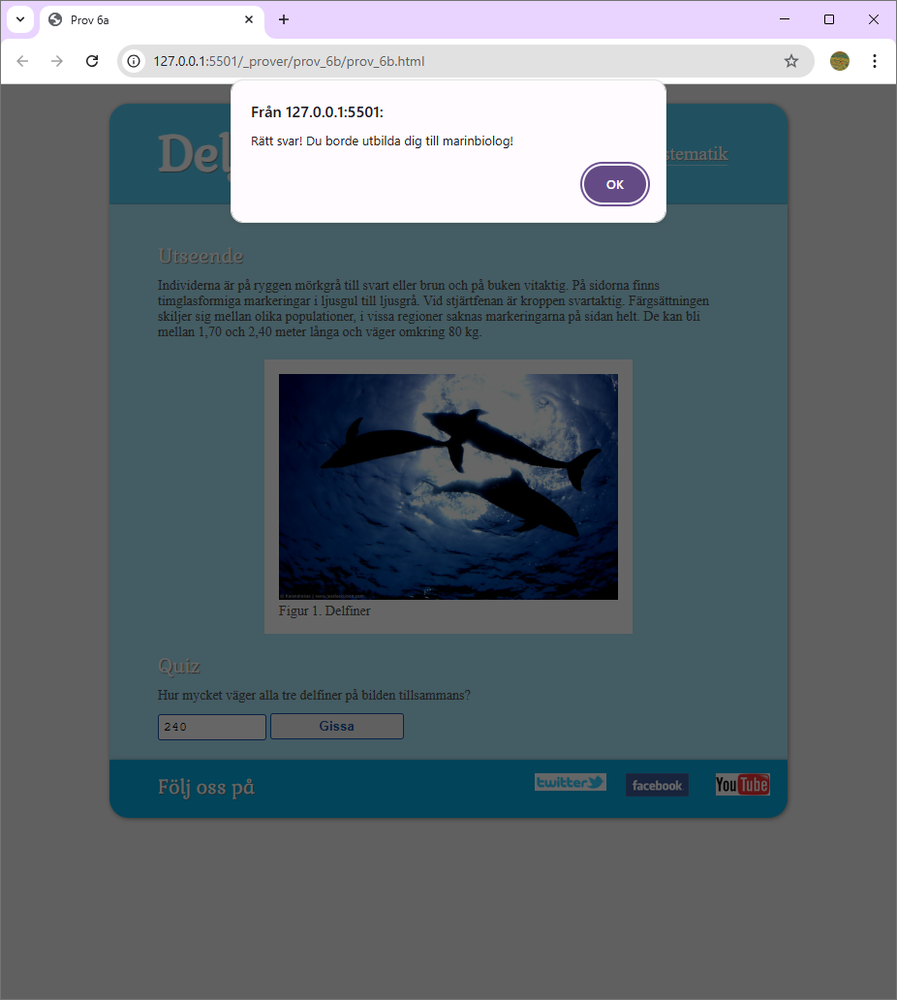

# Prov 6b

## Inspelning av hela provet krävs för godkänt betyg
1. Starta inspelningen i **Chronicler**
1. Arbeta med uppgiften
1. När du är klar **commit & sync**
1. Stoppa inspelningen i **Chronicler** och lämna in videon på **Classroom**

## Provet


## Instruktioner
* Skapa en sida som ser ut som skärmdumpen ovan.
* Designen är 700px bred.
* Placera designen ”centrerat” på sidan.
* Skapa en ”menyn” med rollover-effekt (understruken) och vald-effekt (ljusgrå) som på bilden.
* Använd typsnittet **Gabriella** till rubrikerna och **Karma** till löpande texten:
```css
@import url(http://fonts.googleapis.com/css?family=Gabriela&family=Karma:400,300);
```
* Skapa också en ”quiz” med Javascript som kollar om användaren svara rätt på frågan.

## Kvalité
* Kommentera din kod.
* Indentera din kod så den är tydlig att följa.

## Dokumentation
Du får titta på följande sidor:
* [HTML](https://www.w3schools.com/html)
* [CSS](https://www.w3schools.com/css/default.asp)
* [Javascript](https://www.w3schools.com/js/default.asp)

### CSS-reset

Du kan använda följande CSS-reset för att nollställa alla standardvärden i webbläsaren:
```css
/* Enkel CSS-reset */
html {
    box-sizing: border-box;
}
*, *:before, *:after {
    box-sizing: inherit;
}
body, h1, h2, h3, h4, h5, h6, p, ul {
    margin: 0;
    padding: 0;
}
img {
    max-width: 100%;
    height: auto;
}
```

## Text som används
> Kännetecken Levnadssätt Hot Systematik

> Utseende\
> Individerna är på ryggen mörkgrå till svart eller brun och på buken vitaktig. På sidorna finns timglasformiga markeringar i ljusgul till ljusgrå. Vid stjärtfenan är kroppen svartaktig. Färgsättningen skiljer sig mellan olika populationer, i vissa regioner saknas markeringarna på sidan helt. De kan bli mellan 1,70 och 2,40 meter långa och väger omkring 80 kg.

> Quiz\
> Hur mycket väger alla tre delfiner på bilden tillsammans?

> Följ oss på:

## Färger som används

* <code style="background:#f0f0f0; color:#000">#f0f0f0</code>
* <code style="background:#53cbf1; color:#000">#53cbf1</code>
* <code style="background:#a9e5f8; color:#000">#a9e5f8</code>
* <code style="background:#1456AC; color:#fff">#1456AC</code>
* <code style="background:#888; color:#fff">#888</code>
* <code style="background:#696969; color:#fff">#696969</code>
* <code style="background:#000; color:#fff">#000</code>

## Javascript

När man klickat på "knappen" ska en ruta visas:

### Vid fel svar


### Vid rätt svar

